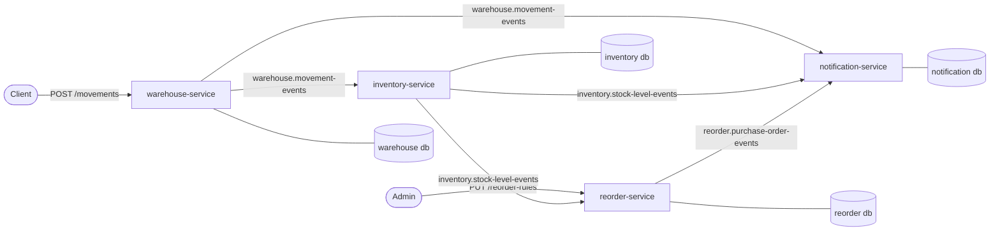

# Warehouse Stock Sync

[](https://github.com/Antorof1/warehouse-stock-sync/actions/workflows/ci.yml)


An event-driven inventory system built with **Spring Boot 4** and **Apache Kafka**. Four microservices keep warehouse stock levels in sync, place purchase orders automatically when stock runs low, and raise notifications. They talk to each other only through Kafka events.

The domain is deliberately small. The interesting part is the messaging: every service gets **reliable, effectively-once processing** from a transactional outbox, idempotent consumers, and retries with dead-letter topics.

## Architecture



| Service                  | Role                                                                                          | Consumes                       | Produces                        |
|--------------------------|-----------------------------------------------------------------------------------------------|--------------------------------|---------------------------------|
| **warehouse-service**    | REST API for recording stock movements (receipts, picks, damage, transfers…)                  | –                              | `warehouse.movement-events`     |
| **inventory-service**    | Keeps the current stock level per SKU and warehouse                                           | `warehouse.movement-events`    | `inventory.stock-level-events`  |
| **reorder-service**      | Places a purchase order when stock drops to the reorder point, and tracks receipts against it | `inventory.stock-level-events` | `reorder.purchase-order-events` |
| **notification-service** | Applies rules (damaged stock, negative stock, bulk movements, PO lifecycle) and sends alerts  | all three topics               | –                               |

Each service owns its own PostgreSQL database. Services share no tables.

## Kafka highlights

- **Transactional outbox** ([`libs/outbox`](libs/outbox)): the event is written in the same DB transaction as the state change, and a ShedLock-guarded poller publishes it to Kafka. No dual writes.
- **Idempotent consumers** ([`libs/idempotency`](libs/idempotency)): a `processed_events` table, written inside the consumer's business transaction, makes redelivered events no-ops.
- **Retry and dead-letter topics** ([`libs/kafka-retry`](libs/kafka-retry)): exponential backoff, then a per-consumer-group DLT (`<topic>.<group>.dlt`). Poison pills go straight to the DLT through `ErrorHandlingDeserializer`.
- **Safe producer settings**: `acks=all`, `enable.idempotence=true`, effectively unlimited retries bounded by `delivery.timeout.ms`.
- **Logical type names** in the `__TypeId__` header (for example `inventory.stock-level.changed`) instead of Java class names, so producers and consumers aren't tied to each other's packages.
- **Per-SKU ordering**: records are keyed by SKU, so all events for one SKU land on the same partition.
- **Observability**: Micrometer metrics for outbox backlog, consumer retries and dead-lettering, plus a ready-made Grafana dashboard.

More detail: **[docs/kafka.md](docs/kafka.md)**.

## Tech stack

Java 21 · Spring Boot 4.1 · Spring Kafka · Apache Kafka 4.3 (KRaft) · PostgreSQL 18 · Flyway · ShedLock · Testcontainers · Prometheus · Grafana · Docker Compose · GitHub Actions

## Quick start

Prerequisites: Docker with Compose, and JDK 21 if you want to run services outside Docker.

**1. Create a `.env` file** from the template:

```bash
cp .env.example .env
```

The defaults work as-is for local use. The file also lists optional port overrides.

**2. Start everything:**

```bash
docker compose --profile full up -d --build
```

| URL                                   | What                                         |
|---------------------------------------|----------------------------------------------|
| http://localhost:8085                 | **Demo simulator** control panel             |
| http://localhost:8081/swagger-ui.html | warehouse-service API                        |
| http://localhost:8083/swagger-ui.html | reorder-service API                          |
| http://localhost:8090                 | Kafka UI (topics, messages, consumer groups) |
| http://localhost:3000                 | Grafana dashboard                            |
| http://localhost:9090                 | Prometheus                                   |

**3. Open the simulator.** The control panel at http://localhost:8085 is the easiest way to see the system work. It generates realistic warehouse traffic, with a simulated supplier that delivers purchase orders. It also runs one-click scenarios (reorder lifecycle, notification rules, poison pill → DLT, burst load) and shows stock levels and a live feed of every Kafka record. See **[docs/simulator.md](docs/simulator.md)**.

**4. Or try it by hand with curl.** Create a reorder rule: when stock of `SKU-1` in `WH-1` falls to 10 or below, order back up to 100.

```bash
curl -X PUT localhost:8083/api/v1/reorder-rules/WH-1/SKU-1 \
  -H 'Content-Type: application/json' \
  -d '{"reorderPoint": 10, "reorderUpTo": 100}'
```

Receive 50 units, then pick 45:

```bash
curl -X POST localhost:8081/api/v1/movements -H 'Content-Type: application/json' \
  -d '{"sku": "SKU-1", "warehouseId": "WH-1", "quantityDelta": 50, "reason": "RECEIPT"}'

curl -X POST localhost:8081/api/v1/movements -H 'Content-Type: application/json' \
  -d '{"sku": "SKU-1", "warehouseId": "WH-1", "quantityDelta": -45, "reason": "PICK"}'
```

Stock is now 5, so reorder-service places a purchase order for 95 units. Follow the notifications:

```bash
docker compose logs -f notification-service
```

Receive the 95 units (`"quantityDelta": 95, "reason": "RECEIPT"`) and the order is marked completed. You can watch every event in Kafka UI.

For running services from your IDE, configuration, and tests, see **[docs/development.md](docs/development.md)**.

## Project layout

```
libs/
  events/         Shared event records, topic names, Kafka serialization config
  outbox/         Transactional outbox (Spring Boot auto-configuration)
  idempotency/    Processed-events tracking for idempotent consumers
  kafka-retry/    Retry with backoff + dead-letter topics
services/
  warehouse-service/
  inventory-service/
  reorder-service/
  notification-service/
  simulator/      Demo tool: traffic generator, scenarios, live control panel
docker/           Postgres init, Prometheus and Grafana provisioning
docs/             Architecture, Kafka design, development guide
```

## Documentation

- [Architecture](docs/architecture.md): services, events, and the end-to-end flow
- [Kafka design](docs/kafka.md): delivery guarantees, outbox, idempotency, retries, DLTs
- [Development](docs/development.md): running locally, configuration, testing, observability
- [Demo simulator](docs/simulator.md): control panel, traffic, scenarios and a demo script
