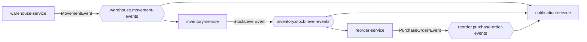
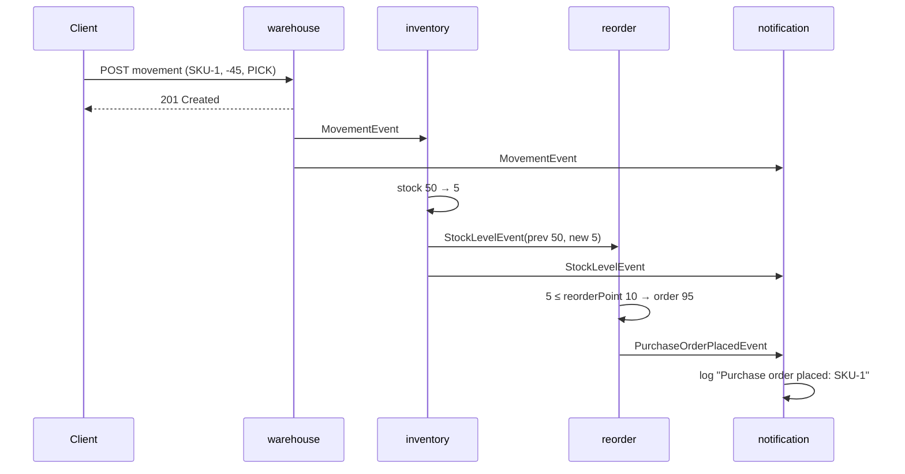

# Architecture

## Overview

The system tracks stock across warehouses. The single source of input is a **stock movement**: a change in quantity of a SKU at a warehouse with a reason. Everything else is derived from movements by services reacting to events.



Services don't call each other over HTTP. Each one owns a PostgreSQL database and publishes facts about its own state changes.

## Services

### warehouse-service

Accepts movements over REST and stores them in the `movements` table.

```
POST /api/v1/movements
{ "sku": "SKU-1", "warehouseId": "WH-1", "quantityDelta": -3, "reason": "PICK" }
```

`reason` is one of `RECEIPT`, `PICK`, `DAMAGE`, `TRANSFER_OUT`, `TRANSFER_IN`, `ADJUSTMENT`. A zero delta is rejected.

The movement row and its `MovementEvent` are written in one transaction (see [outbox](kafka.md#transactional-outbox)).

### inventory-service

Consumes `MovementEvent`s and applies each delta to the `stock` table with an atomic upsert:

```sql
INSERT INTO stock (sku, warehouse_id, quantity) VALUES (...)
ON CONFLICT (sku, warehouse_id) DO UPDATE SET quantity = stock.quantity + EXCLUDED.quantity
RETURNING quantity
```

For every applied movement it emits a `StockLevelEvent` with both `previousLevel` and `newLevel`, so downstream services don't need to keep their own copy of stock.

### reorder-service

Holds **reorder rules** per SKU and warehouse. A rule has a reorder point and a target level:

```
PUT    /api/v1/reorder-rules/{warehouseId}/{sku}   { "reorderPoint": 10, "reorderUpTo": 100 }
GET    /api/v1/reorder-rules
GET    /api/v1/reorder-rules/{warehouseId}/{sku}
DELETE /api/v1/reorder-rules/{warehouseId}/{sku}
```

On each `StockLevelEvent`:

1. If no rule exists for the SKU and warehouse, do nothing.
2. If there is an **open purchase order** and the change is a `RECEIPT`, count the received units toward it. Once the full quantity has arrived, mark it `COMPLETED` and emit `PurchaseOrderCompletedEvent`.
3. If no order is open (or one just completed) and `newLevel <= reorderPoint`, place an order for `reorderUpTo - newLevel` units and emit `PurchaseOrderPlacedEvent`.

There is at most one open order per SKU and warehouse. A partial unique index enforces this, and the rule row is locked with `SELECT … FOR UPDATE` while an event is processed. A scheduled sweeper expires orders still open after `app.purchase-orders.ttl` (7 days by default) and emits `PurchaseOrderExpiredEvent`.

### notification-service

Subscribes to all three topics and runs each event through a list of `NotificationRule`s:

| Rule                         | Trigger                                                            | Severity |
|------------------------------|--------------------------------------------------------------------|----------|
| `DamagedStockRule`           | movement with reason `DAMAGE`                                      | WARNING  |
| `BulkMovementRule`           | \|delta\| ≥ `app.notification.rules.bulk-movement.threshold` (500) | WARNING  |
| `NegativeStockRule`          | stock level below 0                                                | CRITICAL |
| `PurchaseOrderPlacedRule`    | order placed                                                       | INFO     |
| `PurchaseOrderCompletedRule` | order fully received                                               | INFO     |
| `PurchaseOrderExpiredRule`   | order expired before full receipt                                  | WARNING  |

Notifications go to a `NotificationSender`. The included `LogSender` writes them to the log. Adding a rule means adding one `@Component`, and adding a channel (email, Slack…) means another sender implementation.

## Events

All events are Java records in [`libs/events`](../libs/events), shared by every service. Each has a UUID `id` used for idempotency.

| Topic                           | Type header                        | Payload                                                                                          | Key |
|---------------------------------|------------------------------------|--------------------------------------------------------------------------------------------------|-----|
| `warehouse.movement-events`     | `warehouse.movement.recorded`      | `MovementEvent(id, sku, warehouseId, quantityDelta, reason, occurredAt)`                         | sku |
| `inventory.stock-level-events`  | `inventory.stock-level.changed`    | `StockLevelEvent(id, sku, warehouseId, newLevel, previousLevel, reason, occurredAt)`             | sku |
| `reorder.purchase-order-events` | `reorder.purchase-order.placed`    | `PurchaseOrderPlacedEvent(id, sku, warehouseId, quantity, occurredAt)`                           | sku |
|                                 | `reorder.purchase-order.completed` | `PurchaseOrderCompletedEvent(id, sku, warehouseId, orderedQuantity, placedAt, occurredAt)`       | sku |
|                                 | `reorder.purchase-order.expired`   | `PurchaseOrderExpiredEvent(id, sku, warehouseId, orderedQuantity, receivedQuantity, occurredAt)` | sku |

The purchase-order topic carries three event types. Consumers dispatch on the type header using `@KafkaHandler` methods.

## End-to-end example



## Databases

| Service      | Tables                                                                  |
|--------------|-------------------------------------------------------------------------|
| warehouse    | `movements`, `outbox_events`                                            |
| inventory    | `stock`, `outbox_events`, `processed_events`                            |
| reorder      | `reorder_rules`, `purchase_orders`, `outbox_events`, `processed_events` |
| notification | `processed_events`                                                      |

Each service applies its own Flyway migrations. The `outbox` and `idempotency` libraries ship their tables as separate Flyway migration sets with their own history tables, so they don't clash with service migrations.
