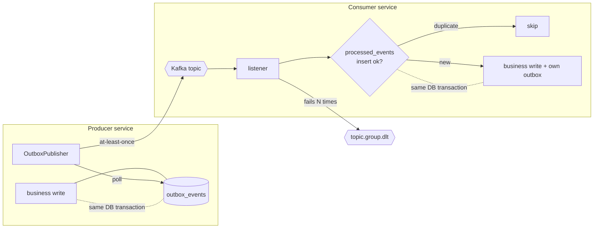

# Kafka design

This project's goal is to make an event pipeline survive crashes, broker outages, redeliveries, and bad messages without losing or double-applying events. This page explains how.

## Delivery guarantees in one picture



- **Producing** is at-least-once and never lost: the event is committed with the state change.
- **Consuming** is at-least-once delivery with an idempotent effect, so the result is *effectively once*.
- **Failures** retry with backoff and are then parked on a dead-letter topic, so one bad record doesn't block the partition.

## Transactional outbox

`libs/outbox` · `OutboxEventService`, `OutboxPublisher`, `OutboxSweeper`

Writing to the database and then calling `kafkaTemplate.send()` is a dual write. If the process dies between the two, the event is lost, or published for a change that rolled back. Instead, services call:

```java
outboxEventService.record(id, Topics.MOVEMENT_EVENTS, sku, event);
```

`record` requires an active transaction (`Propagation.MANDATORY`), so the event can only be saved together with the business change. It serializes the payload to JSON and stores it in `outbox_events`.

`OutboxPublisher` runs every `poll-interval`:

1. Load up to `batch-size` unpublished rows, oldest first.
2. Send them all asynchronously, then wait for the acks.
3. Mark the acknowledged rows `published_at = now()`.

Details:

- **ShedLock** (`outbox_shedlock` table, DB time) makes sure only one instance of a service polls at a time, so scaling a service horizontally doesn't publish each event several times.
- If Kafka is unreachable (a `RetriableException`), the batch stops early and the remaining rows wait for the next poll.
- A crash between "Kafka acked" and "row marked" causes a re-publish on the next poll. That is acceptable because consumers are idempotent.
- `OutboxSweeper` deletes published rows older than `retention` (7 days).

| Property                      | Default  |
|-------------------------------|----------|
| `app.outbox.enabled`          | `true`   |
| `app.outbox.poll-interval`    | `PT0.5S` |
| `app.outbox.batch-size`       | `100`    |
| `app.outbox.retention`        | `P7D`    |
| `app.outbox.sweep-interval`   | `PT1H`   |
| `app.outbox.schema-migration` | `true`   |

## Producer configuration

Shared via `libs/events/src/main/resources/events-kafka.yaml`, which every service imports:

```yaml
acks: all
enable.idempotence: true
max.in.flight.requests.per.connection: 5
retries: 2147483647
delivery.timeout.ms: 60000
```

With idempotence on, the broker drops duplicate sends from producer retries, and up to 5 in-flight requests still keep per-partition order. Retrying is bounded by `delivery.timeout.ms`, not by a retry count.

## Idempotent consumers

`libs/idempotency` · `ProcessedEventService`

Every event has a UUID. Before doing any work, a consumer runs:

```sql
INSERT INTO processed_events (event_id, event_topic) VALUES (?, ?) ON CONFLICT DO NOTHING
```

If no row was inserted, the event was already handled and is skipped. In inventory-service and reorder-service this insert runs **inside the same transaction** as the business update and the outbox write:

```java
@Transactional
public void process(MovementEvent event) {
    if (!processedEventService.tryMarkProcessed(event.id(), Topics.MOVEMENT_EVENTS)) return;
    stockService.applyMovement(...);   // also records StockLevelEvent in the outbox
}
```

So "mark as processed", "apply the change" and "emit the next event" either all commit or all roll back. If the transaction fails, the offset isn't committed, the record is redelivered, and the work runs again cleanly.

The primary key is `(event_id, event_topic)`. A `ProcessedEventPruner` removes entries older than `app.idempotency.pruning.retention` (14 days by default). That window must be longer than any realistic redelivery delay.

## Retries and dead-letter topics

`libs/kafka-retry` · `KafkaRetryAutoConfiguration`

Each consuming service gets a `DefaultErrorHandler` with exponential backoff:

| Property                                   | Default |
|--------------------------------------------|---------|
| `app.kafka.retry.enabled`                  | `true`  |
| `app.kafka.retry.max-retries`              | `4`     |
| `app.kafka.retry.initial-interval`         | `PT1S`  |
| `app.kafka.retry.multiplier`               | `2.0`   |
| `app.kafka.retry.max-interval`             | `PT10S` |
| `app.kafka.retry.not-retryable-exceptions` | –       |

When retries run out, the record goes to a dead-letter topic named per consumer group:

```
<source-topic>.<consumer-group>.dlt
e.g. warehouse.movement-events.inventory-service.dlt
```

Naming the DLT per group matters because one topic has several consumers. If inventory-service fails on a record, notification-service may have processed it fine, so replaying from a shared DLT would be wrong.

**Poison pills**: consumers wrap the JSON deserializer in `ErrorHandlingDeserializer`. A record that can't be deserialized becomes a `DeserializationException`, which Spring Kafka treats as not retryable, so it goes straight to the DLT with the original bytes. A dedicated `DeadLetterTemplate` serializes `byte[]` values as-is and objects as JSON, so both cases are preserved.

## Serialization and type mapping

Producers write JSON as plain strings (from the outbox) and set the `__TypeId__` header to a **logical name** rather than a class name:

```yaml
spring.json.type.mapping: >
  warehouse.movement.recorded:com.github.antorof1.events.MovementEvent,
  inventory.stock-level.changed:com.github.antorof1.events.StockLevelEvent,
  reorder.purchase-order.placed:...PurchaseOrderPlacedEvent,
  ...
```

The same mapping is used on both sides. The outbox looks up the logical name when it records an event, and consumers resolve it back to a class. Renaming or moving a Java class therefore doesn't break messages already on the topic, and a consumer could even be written in another language.

## Topics and partitioning

| Topic                           | Partitions | Created by                     |
|---------------------------------|------------|--------------------------------|
| `warehouse.movement-events`     | 3          | warehouse-service              |
| `inventory.stock-level-events`  | 3          | inventory-service              |
| `reorder.purchase-order-events` | 3          | reorder-service                |
| `*.<group>.dlt`                 | 3          | each consumer for its own DLTs |

Each topic is declared as a `NewTopic` bean by the service that owns it (`app.kafka.topics.auto-create`). Replicas are set to `-1` (broker default), so the same code works on a single-node dev broker and a real cluster.

All records are **keyed by SKU**, so every event for a SKU lands on the same partition and is consumed in order. That ordering matters: inventory reports `previousLevel → newLevel`, and reorder-service relies on seeing stock changes for a SKU in sequence.

## Known trade-offs

- **Notification side effects aren't transactional.** notification-service marks an event as processed before sending, so a failing sender would drop that notification instead of retrying it. That's fine for logging, but a real email or Slack sender would want mark-and-send in one unit, or a notification outbox.
- **Ordering inside an outbox batch.** If one send in a batch fails asynchronously while later ones succeed, the failed event is retried on the next poll and can arrive after newer events for the same key.
- **Polling latency.** The outbox adds up to `poll-interval` (500 ms) of latency. Change Data Capture (Debezium) would remove the polling but adds infrastructure.
