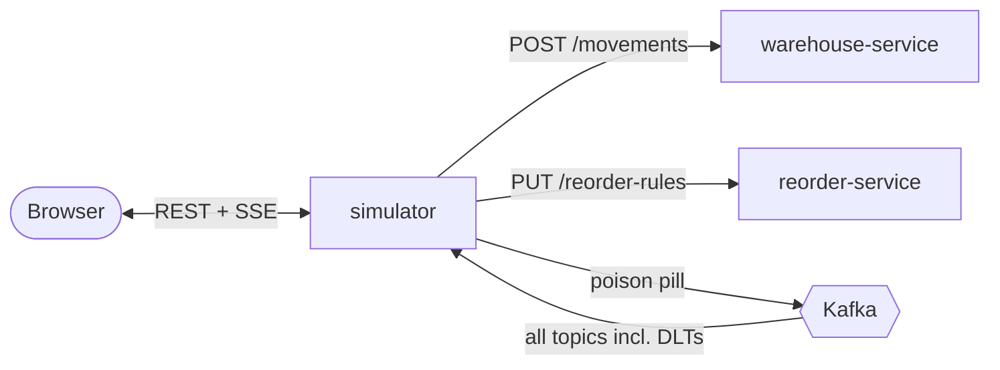

# Demo simulator

`services/simulator` is a demo tool, not part of the domain. It drives the system through its public interfaces (the REST APIs and Kafka) and shows what happens in a browser control panel, so a live demo doesn't depend on typing `curl` commands.

It starts with the rest of the stack:

```bash
docker compose --profile full up -d --build
```

Then open **http://localhost:8085**. Nothing happens until you press a button.

## Control panel

| Area                   | What it shows or does                                                                                                              |
|------------------------|------------------------------------------------------------------------------------------------------------------------------------|
| Header                 | Health of each service (from `/actuator/health`) and links to Grafana, Kafka UI and the Swagger UIs                                |
| **Background traffic** | Start/stop and a rate slider (0.2–50 movements/s)                                                                                  |
| **Supplier**           | Delivers purchase orders automatically after a configurable lead time                                                              |
| **Scenarios**          | Scripted stories you run one at a time, with a step-by-step log to narrate from                                                    |
| **Stock levels**       | Every SKU and warehouse: current level, a bar against its reorder rule, and the latest purchase order with receipt progress        |
| **Live Kafka feed**    | Every record on every topic, dead letter topics included, with a one-line summary and the raw payload. Filter by topic or pause it |

The panel updates over server-sent events twice a second.

## Background traffic

Starting traffic the first time seeds the catalog configured in `application.yaml` (6 SKUs × 2 warehouses): it upserts a reorder rule for each item and receives opening stock up to the rule's target for items with no stock. After that, each tick picks a random item and sends one of:

| Movement                       | Share | Notes                                                           |
|--------------------------------|-------|-----------------------------------------------------------------|
| `PICK`                         | 70%   | At most half the known level, capped by `app.traffic.max-pick`  |
| `TRANSFER_OUT` + `TRANSFER_IN` | 15%   | Moves stock towards the warehouse holding the least of that SKU |
| `ADJUSTMENT`                   | 12%   | ±1–3, a cycle count correction                                  |
| `DAMAGE`                       | 3%    | 1–2 units, so `DamagedStockRule` fires now and then             |

Traffic never sends receipts. Stock only comes back through the supplier, so every item keeps cycling through *drain → reorder point → purchase order → delivery*.

## Supplier

When reorder-service places a purchase order for a catalog item, the supplier delivers it as `RECEIPT` movements: 60% after the lead time, the rest one lead time later. This shows partial receipts being counted toward the open order. It only delivers orders placed after the simulator started, and never touches scenario SKUs.

## Scenarios

Each scenario uses a fresh SKU (`DEMO-<NAME>-<suffix>` in `WH-1`), so it starts from empty stock and runs the same way every time. Steps pause for 2 seconds so you can point at the feed, and each step waits for the expected event before moving on. A step that doesn't see its event within 30 seconds fails the scenario.

| Scenario               | What happens                                                                                                                                                                                                             | Where to look                                               |
|------------------------|--------------------------------------------------------------------------------------------------------------------------------------------------------------------------------------------------------------------------|-------------------------------------------------------------|
| **Reorder lifecycle**  | Rule (10 → 100), receive 50, pick 45, so stock is 5 and a PO for 95 is placed. Deliver 40 (PO stays open), deliver 55, and the PO completes.                                                                             | Stock row, PO progress bar, `reorder.purchase-order-events` |
| **Notification rules** | Receive 20, damage 3, bulk receipt of 600, oversell into negative stock, then a cycle count back to 0                                                                                                                    | `docker compose logs -f notification-service`               |
| **Poison pill → DLT**  | Publishes malformed JSON straight to `warehouse.movement-events`. inventory-service and notification-service each dead-letter it without retrying. A valid movement for the same SKU (same partition) then goes through. | Red entries in the feed, `.dlt` topics in Kafka UI          |
| **Burst load**         | Sends 2,000 movements (configurable up to 20,000) from 16 concurrent clients as `+n`/`-n` adjustment pairs, so stock ends where it started. Then waits for the pipeline to drain.                                        | Grafana: outbox backlog, consumer lag, listener latency     |

## How it works



- inventory-service has no read API, so the simulator **rebuilds stock levels and purchase orders from Kafka**, like any other downstream consumer. It reads every topic matching `(warehouse|inventory|reorder)\..+` as plain strings, which is why it can display poison pills.
- On startup, it reads each partition from the beginning, so a restarted simulator shows the current state again.
- It has no database. Everything it knows comes from Kafka or reorder-service's `GET /api/v1/reorder-rules`.

The control panel's REST API is under `/api/v1/simulator` and documented at http://localhost:8085/swagger-ui.html.

## Configuration

All settings live under `app.*` in `services/simulator/src/main/resources/application.yaml`:

| Property                                                  | Default                 | Meaning                                                       |
|-----------------------------------------------------------|-------------------------|---------------------------------------------------------------|
| `app.services.{warehouse,inventory,reorder,notification}` | `http://localhost:808x` | Service base URLs. Compose points them at the containers      |
| `app.catalog.warehouses`, `app.catalog.skus`              | 2 warehouses, 6 SKUs    | What background traffic and the supplier work with            |
| `app.traffic.rate`                                        | `2.0`                   | Initial movements per second                                  |
| `app.traffic.max-pick`                                    | `12`                    | Largest single pick                                           |
| `app.supplier.enabled`                                    | `true`                  | Deliver purchase orders automatically                         |
| `app.supplier.lead-time`                                  | `8s`                    | Delay before each shipment                                    |
| `app.supplier.partial-shipments`                          | `true`                  | Split deliveries 60/40                                        |
| `app.scenarios.step-delay`                                | `2s`                    | Pause between scenario steps                                  |
| `app.scenarios.await-timeout`                             | `30s`                   | How long a step waits for its event                           |
| `app.scenarios.bulk-quantity`                             | `600`                   | Bulk receipt size; keep it ≥ notification-service's threshold |
| `app.scenarios.burst-size`                                | `2000`                  | Default burst size                                            |

To run it from the IDE against Compose infrastructure, start the four services on ports 8081–8084 and then:

```bash
./mvnw -pl services/simulator spring-boot:run -Dspring-boot.run.arguments=--server.port=8085
```

## Demo script

1. Open the control panel, Kafka UI and Grafana side by side.
2. **Start traffic.** The seeding receipts show up first, then a steady stream of picks and transfers. Point out that a single movement produces a `MovementEvent` and then a `StockLevelEvent`.
3. Wait for an item to cross its reorder point: a purchase order appears, then the supplier's partial and final receipts complete it.
4. **Stop traffic** and run **Reorder lifecycle** to narrate the same flow step by step.
5. Run **Notification rules** with the notification-service log open.
6. Run **Poison pill → DLT**: the feed shows the bad record, the two dead letters, and the valid movement right after.
7. Run **Burst load** and switch to Grafana to show the outbox backlog spike and drain.
